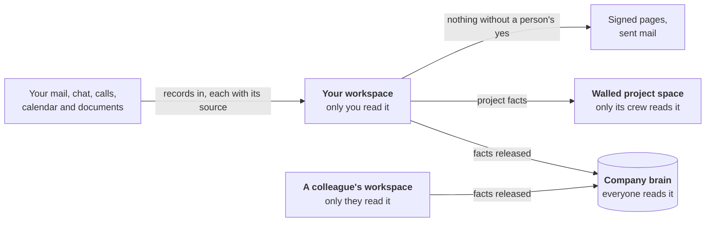
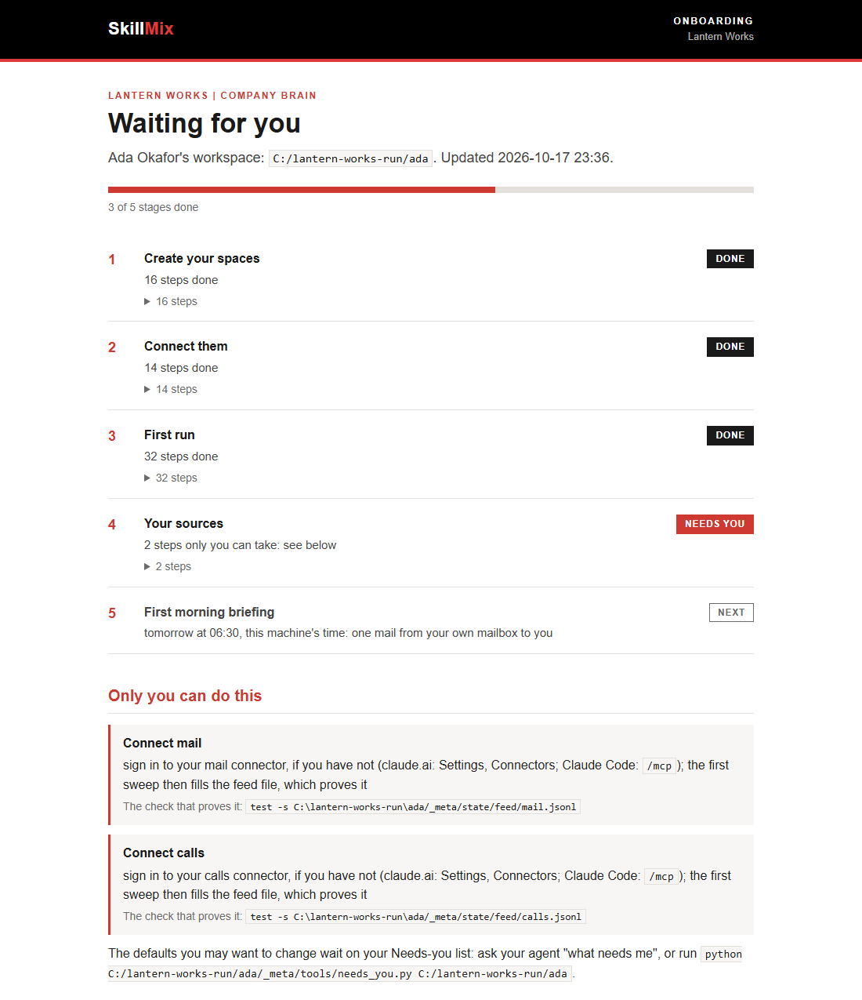

# Company brain template

**A company memory your AI agents keep and your people sign.**

Company knowledge is scattered across mail, chat, calls and documents, AI agents forget it
between sessions, and handing all of it to one feels risky. Say one sentence to Claude Code
and it sets this up: your agent keeps everything in git with a source on every line, and
private work stays private.

[How it works](#how-it-works) · [What you get](#what-you-get) ·
[Try it](#try-it-in-one-minute-no-account) · [Start](#start-in-one-sentence) ·
Agents: read [For agents](#for-agents) first

## How it works

1. **It reads what you already have.** Your agent copies your own mail, chat, calls, calendar
   and documents into your workspace, a private git repository made for you alone. Every
   record keeps its source. Personal and school records are counted, never stored.
2. **It decides what may travel, and a second agent checks.** For each record an agent decides
   whether it stays with you or informs a client or project, and where that belongs: the
   company brain everyone reads, or a walled project space only its crew reads. Nothing about a
   client leaves your workspace until its owner's agent has classified it.
3. **People sign, and the rest is rebuilt every day.** Pages the agent drafts wait on your
   Needs-you list for a yes. Status pages and the morning briefing are rebuilt from the records
   every day, and answers name the page behind each line and how old it is.



Each space is a private git repository in your GitHub organization or account. The brain is
mounted read-only in every workspace and project, so every agent starts from what the company
already knows.

## What you get

**Day one:** one sentence sets up your workspace, mounts the brain and the projects you work
on, runs the first sweep and shows the open items of your projects. **By the end of week
one:** a briefing every morning, a short list of what needs you, and the first pages people
signed.

The examples come from the fixture company Lantern Works, which is fictional and ships with
the template. Most are lines from one fixture run, a few shortened; the gate example is
written for this page.

### A morning briefing

One mail a day, sent from your own mailbox to yourself. It carries counts; the items stay in
your workspace.

```
Morning briefing: 5 items need you

TODAY
  4  items held back in doubt
  3  updates that landed here silently this week
  2  notes waiting for your signature
  ...
```

### Answers with sources

Ask in plain words. The answer ends with every page it rests on, with its tier and its age:

```
> When does Harbor go live?
November 3, says the signed Harbor page. A mail of October 17 says November 10;
that one is unverified, and it waits on Ada's Needs-you list.
- Harbor (signed, mine, 2026-10-17, 0 days)
- Harbor go-live date: 2026-11-10 (witness, mine, 2026-10-17, 0 days)
company view as of 2026-10-17
```

### A status page per client and project

Rebuilt from the records on every run and never signed:

```
# Harbor: status
## Open
### We owe
- Harbor go-live date: 2026-11-10 (witness, mine, 2026-10-17, p-7b745748)
### Waiting for a signature
- Harbor (pending, mine, 2026-10-17, p-c2509733)
## Coming up
- 2026-11-10: Harbor go-live date: 2026-11-10 (witness, mine, 2026-10-17)
```

### A Needs-you list instead of an inbox

Each item says what the agent recommends and what happens if you say nothing. Answer in a
session, or reply to the briefing and confirm in your next session:

```
1. Harbor: the page says live date 2026-11-03; m-ada-006 of 2026-10-17 says
   2026-11-10. I recommend: 2026-11-10. If nothing: the page stays as it is.
2. Weekly review: 1 page to confirm, retire or correct. I recommend: yes.
3. Harbor for harbor: sign? I recommend: yes. If nothing: stays a draft.
4. Held in doubt: 4. I recommend: leave them home.
Answer with the number and yes, edit, no, later or always; then submit.
```

### A gate that decides what may travel

Nothing about a client, project or deal leaves the space it came into until its owner's agent
classifies it: `company` (it goes to the brain), `walled` (to its crew's own space) or `owner`
(it stays home). The agent asks the other workspaces first. They answer in facts only, the
kind of an obligation and its date, never its wording:

```
Ben's workspace:  Alder Clinic: obligation seen, confidentiality, 2026-04-14
Ada's workspace:  Alder Clinic classified walled, crew Ada and Ben
Needs you (Ada):  Make the private space alder-clinic for Alder Clinic, shared with ada, ben?
                  I recommend: yes. If nothing: the space is made on 2026-10-19.
```

### Nothing signed or sent without a person

The agent drafts mail into `outbox/` and you send it. A page turns `stable` only after your
yes and `submit`, and the fingerprint of the exact text you approved travels with it:

```
status: stable
signed_by: Ada Okafor
signed_at: '2026-10-17T23:32:35Z'
fingerprint: 1d496e3904fec7e7ba6640971e6a81c435c4813faf24fbc018e97f8c23f75f64
```

## Try it in one minute, no account

You need git and Python 3.10 or newer (`python3` on macOS and Linux).

    git clone https://github.com/OWNER/REPOSITORY company-brain
    cd company-brain
    python -m pip install pyyaml
    python _meta/tools/onboard.py --fixture ../lantern-works

If pip refuses with "externally managed environment", run the last two lines inside a virtual
environment (`python -m venv .venv`, then activate it).

The fixture builds Lantern Works offline from `_meta/tests/fixture/`: a brain, three
workspaces, two projects and two corridors. It runs a week of sweeps on a fast clock, applies
the owners' verdicts, then runs the answer and leak tests. That takes about half a minute on
Linux and a few minutes on Windows, and ends with one table:

```
space       cand signed released held   answers     leaks
brain          0      0        0    0         -       1/0
ada            2      1        0    4       1/0         -
ben            2      0        0    1       2/0         -
chloe          2      1        0    0       2/0       2/0
harbor         1      1        0    0         -       1/0
beacon         0      0        0    0         -       1/0
```

The columns are candidates waiting, pages signed, releases received, items held at home, and
the answer and leak tests as passed/failed. A legend repeats that under the table, and the last
line says `fixture: passed`, or `fixture: failed` with what failed. Then open what it made:
`onboarding.html` is the page Ada sees when setup finishes, `ada/live/needs-you.md` is Ada's
list, `ada/live/subjects/harbor.md` her status page for Harbor, and `brain/live/projects.md` the
company's register.

**Proof.** More than 700 unit tests, 61 behaviour scenarios and an offline setup run on Linux,
macOS and Windows, and every pull request to the template rebuilds the fixture. In an internal pilot, one
client's history was backfilled and 12 questions were put to the new answers and to a
hand-kept vault, judged against the original records. The new answers scored 4.8 of 5 for
grounded in sources (hand-kept: 3.8), 4.8 for current (4.1) and 4.1 for correct (3.4), and
were better on 9 of the 12.

## What it costs

- **Claude Code**, on your own plan or API key. Each person's routines are four agent runs a
  day (three sweeps, one daily chain). The first sweep reads your last 90 days, so day one is
  the longest run.
- **GitHub Actions minutes** on private repositories. Each sync pull request runs one check,
  about one billed minute. The sync task runs every 15 minutes but only opens a pull request
  when something changed: the routines' output when it lands, journal lines at most hourly,
  run lines at most every six hours. That is roughly 10 to 25 billed minutes a day for a
  person's workspace, and fewer for the brain and each project.
- There is no server, hosted service or database to run. Search is plain text until you turn
  an engine on.

## What it never does

- Send, post, spend or delete. The only mail it sends goes from you to you: the briefing, and
  notices only you can act on.
- Sign. Only a person's verdict makes a page `stable`.
- Widen its own authority, or grant anyone access to a repository.
- Put a secret in a repository. The scan blocks keys, tokens and passwords, and counts a hit
  without quoting it.
- Store your personal or school records. It counts them and writes them nowhere.
- Phone home. There is no telemetry and no service of ours in the loop: your data lives in your
  repositories and on your machines, and the model your agent uses reads what the agent reads.

## Start in one sentence

You need git, GitHub's `gh` and Python 3.10 or newer. One command installs all three:

- macOS: `brew install git gh python`
- Debian or Ubuntu: `sudo apt install git gh python3 python3-venv`
- Windows: `winget install Git.Git GitHub.cli Python.Python.3.12`

Then open Claude Code (the desktop app's Code tab, or the CLI) in any folder and say one sentence:

- **A company with no brain yet:** "Set up our company brain from
  https://github.com/OWNER/REPOSITORY" (this repository's address).
- **Joining a company:** the sentence from your invitation, for example "Onboard me to Lantern
  Works: https://github.com/OWNER/REPOSITORY with my invitation lantern-works/lantern-works-brain:ada".

That is all. The agent copies this template and runs `_meta/tools/start.py`, which does every
step itself. It reads who you are from git and your host account, finds your invitation,
creates your repositories from this template and clones them, fills `space.yaml`, and mounts
the brain and the projects you are crew on. It installs one instruction at user level so every
session in any repository journals in your workspace, and allows your workspace for the
harness. It registers the sync task, arms auto-merge and the required check, runs the first
sweep, the status pass and the tests, and renders your two routines for the agent to schedule.
Every question has a default; the ones you may want to change come back on your Needs-you list.

What only you can do: sign in to GitHub once (`gh auth login`) if you never did, and sign in
to your own mail, calendar and chat when you connect them. The tool lists each with the check
that proves it. Your first morning briefing arrives the next day.

While it runs, `start.py` keeps a page at `~/.spaces/onboarding.html` and your agent opens it:
what is done, what runs now, what is next, what only you can do, and how the system works.
After setup the same page shows your day: the last sweep, what needs you and what leaves
tomorrow. `onboard.py --check` brings it up to date.



### For agents

When a person asks to be set up, onboarded or to start, and names this repository:

1. Clone it to a short folder: `gh repo clone OWNER/REPOSITORY ~/.spaces/template` (on Windows
   run `git config --global core.longpaths true` first; without `gh`, install it from
   https://cli.github.com, on Windows `winget install --id GitHub.cli -e`; not signed in, ask
   the person to run `gh auth login --web` once). The person's sentence is the go-ahead for
   every step below: say what you are doing and go on.
2. Run `sh <temporary folder>/_meta/tools/bootstrap.sh` (Windows: `powershell -NoProfile
   -ExecutionPolicy Bypass -File <temporary folder>\_meta\tools\bootstrap.ps1`). It finds or
   installs Python 3.10+ and runs `_meta/tools/start.py`, whose doctor checks this machine first
   and installs what needs no password. Pass it `--invitation <brain>:<slug>` when the person
   gave an invitation, `--company "<name>"` when they named their company, and `--feeds <list>`
   naming the connectors your session has (mail, calendar, chat, calls, tracker, documents).
   Ask nothing else: every other answer has a default. Open the page it prints (`page:`,
   `~/.spaces/onboarding.html`) in the person's browser; reload it after each step below.
3. Each `doctor:` row in `yours` is one sentence for the person with the exact command (a
   sign-in, a password, a dialog, an access grant): ask once, wait, then run step 2 again.
4. Schedule the two routines it rendered under `_meta/state/routines/` in the new workspace
   with your harness's scheduled tasks, each at its `schedule` (cron in the machine's local
   time). Without scheduled tasks, run
   `python <workspace>/_meta/tools/onboard.py <workspace> --os-routines`: the OS scheduler runs
   them through `claude -p`.
5. Follow steps 7 to 9 of `.claude/skills/onboard/SKILL.md` in the clone: quiet GitHub
   notifications for the repositories they just got, one sweep chain now, and an answer that
   shows the open items of the projects they are crew on.

Run again, `start.py` changes nothing that is right: it adopts the repositories it made.

Where they go: the person's own GitHub account, the brain named `<company>-brain`. Pass
`--org <name>` to put them in an organisation instead. A person who belongs to an organisation
and gave no `--org` gets a `namespace` row in `yours`: ask them once which account, then run
step 2 again with `--org`.

### Without an agent

Create a repository from this template, clone it, `pip install pyyaml`, then run
`python _meta/tools/onboard.py` and answer the questions (press Enter for each default, type
`skip` to decide later). `python _meta/tools/onboard.py --check` tells you what is missing
without changing anything.

## Invite a colleague

In the brain, run `python _meta/tools/onboard.py . --invite <slug>`, or ask your agent "invite
<name>". It writes the colleague's invitation (their name, the brain, the projects they are
crew on) and puts one item on your Needs-you list with the sentence to send them. They say it
in Claude Code on their own machine and their agent does the rest in about fifteen minutes,
mostly their sign-ins. Nothing is done for them. Someone not in the registry yet is added by the
same command with `--name "<full name>"` (and `--email <address>`). Until they can read the
brain, a second item asks you to give them access.

## Add a client

In the brain, or ask your agent "add the client <name>":

    python _meta/tools/registry.py . add "Dune Bakery" --kind clients --domain dune.example --owner "Ada Okafor"

Mail from that domain is then matched to the client. Nothing about it leaves the workspace it
came into until its owner's agent classifies it: your Needs-you list counts what waits ("2 wait
for a classification (Dune Bakery)"), and a route to the brain is refused as unclassified.
Projects and deals are added the same way (`--kind projects --part-of <client>`).

## Start a project from a desk seed

When something on your desk gains a second reader, mint it:

    python _meta/tools/mint.py . --seed work/projects/<subject>/<effort> --name <project> --crew "Ada Okafor" "Ben Liu"

The seed's pages become the project's first drafts, the subject's home moves to the new space
(its id does not), and the platform team is proposed on your Needs-you list.

## What runs

- **Routines**, each a tool under `_meta/tools/` and a skill under `.claude/skills/`:
  `sweep` → `route` → `distill` → `check` three times a day, and `status` → `release` →
  `morning-view` once a day. They write files and queue items; they never sign, send, post or spend.
- **The sync task**: `_meta/tools/sync.py` every 15 minutes through the OS scheduler
  (`schtasks` on Windows, cron elsewhere). It commits what sessions left and opens the pull
  request, and the host merges it when `checks` is green. Nothing else runs git.
- **Needs you**: `python _meta/tools/needs_you.py .` shows what waits for a person.

## Read more

- `rules.md` is the constitution: the hard rules, the high-stakes list, the badge floors.
- `docs/shape-1.md` states what any agent may assume about a space and must never do.
- `docs/decisions.md` records why things are the way they are; `docs/superpowers/specs/` holds
  the designs behind the newest parts.
- `docs/data-protection.md` says what is copied where, who reads it, and what to check with
  counsel.
- `docs/troubleshooting.md` lists what can go wrong during setup and what the agent does.
- [SECURITY.md](SECURITY.md), [CONTRIBUTING.md](CONTRIBUTING.md), [CHANGELOG.md](CHANGELOG.md).

## License

MIT, see `LICENSE`.
